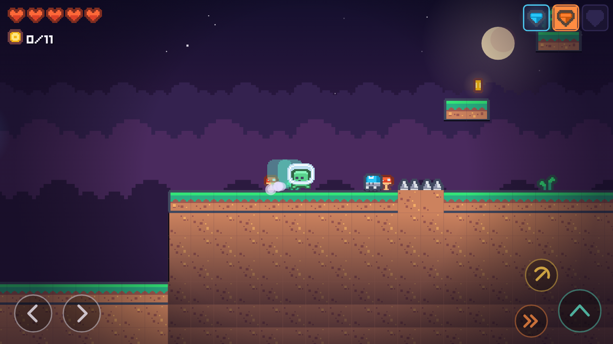

# Shadow Relic 🗡️

Metroidvania complet en **Flutter + Flame**, en pixel art (sprites et polices Kenney, licence CC0).
Compile et tourne tel quel sur mobile, desktop et web.


| Exploration | Dash | Le Gardien |
|---|---|---|
|  |  |  |

## Lancer le jeu

```bash
flutter pub get
flutter run -d macos     # ou : -d chrome, un téléphone, etc.
```

## Contrôles

| Action   | Clavier               | Tactile (mobile)   |
|----------|-----------------------|--------------------|
| Bouger   | Flèches / WASD / ZQSD | ◀ ▶                |
| Sauter   | Espace / ↑ / Z / W    | bouton saut        |
| Dash     | Maj / C               | bouton dash        |
| Attaquer | X / J                 | bouton attaque     |
| Pause    | Échap / P             |                    |
| Jouer    | Entrée (menu)         |                    |

## Progression (ability gating)

1. **Double saut** (gemme bleue) : plateformes après le départ
2. Mur de 4 tuiles franchissable → plateau
3. **Dash** (gemme orange) : en hauteur, nécessite le double saut
4. Caisses industrielles brisées au dash → couloir
5. **Saut mural** (gemme verte) : piédestal avant la tour
6. Tour verticale en saut mural → arène du **Gardien** (boss 2 phases)

## Fonctionnalités

- **Physique** : coyote time, jump buffering, saut variable, dash avec cooldown, glissade et saut mural
- **Combat** : attaque mêlée, i-frames, recul, ennemis patrouilleurs, boss avec ondes de choc et phase enragée
- **Game feel** : squash & stretch, images rémanentes du dash, hit-stop, secousses de caméra,
  caméra lissée qui anticipe le regard, poussière, particules et halos lumineux
- **Décor** : ciel de crépuscule, lune, étoiles scintillantes, 3 couches de parallaxe,
  raccords d'herbe automatiques, ombrage en profondeur, décorations générées
- **Interface** : écran titre sur le niveau qui défile en démo, pause floutée avec statistiques,
  écran de victoire (pièces, temps, morts), HUD pixel art, bannières animées,
  contrôles tactiles uniquement sur mobile
- **Sauvegarde** : capacités, pièces ramassées, checkpoints allumés, morts et temps de jeu
  (`shared_preferences`)

## Architecture (clean architecture)

Les dépendances vont toujours vers l'intérieur : `presentation` -> `domain` <- `data`.
Le domaine est en Dart pur (aucun import Flutter ni Flame) et testable isolément.

```
lib/
├── main.dart                        # point d'entrée
├── injection.dart                   # assemblage data -> domain -> presentation
├── core/
│   ├── constants.dart               # tuile 18 px, échelle, résolution 480x270
│   └── palette.dart                 # couleurs partagées
├── domain/                          # règles du jeu, Dart pur
│   ├── entities/                    # Ability, Tile, Spawn, LevelGrid, GameProgress
│   ├── physics/collision.dart       # moteur de collision AABB sur grille
│   ├── repositories/                # contrats LevelRepository, ProgressRepository
│   └── usecases/                    # LoadLevel, Load/HasSaved/Save/ClearProgress
├── data/                            # implémentations concrètes
│   ├── datasources/                 # carte ASCII (124x30), parseur, shared_preferences
│   ├── models/game_progress_model.dart  # sérialisation JSON versionnée
│   └── repositories/                # AsciiLevelRepository, LocalProgressRepository
└── presentation/                    # Flutter + Flame
    ├── app.dart                     # MaterialApp + GameWidget
    ├── game/                        # ShadowRelicGame, caméra, entrées clavier / tactile
    ├── sprites/                     # découpe des planches Kenney, helpers de rendu
    ├── components/                  # joueur, ennemis, boss, objets, fx, tuiles, décor
    ├── hud/                         # HUD + contrôles tactiles
    └── overlays/                    # menu, pause, victoire
```

## Assets

Graphismes et polices : [Kenney](https://kenney.nl) (CC0), détail dans
[`assets/CREDITS.md`](assets/CREDITS.md).

## Tests

```bash
flutter analyze
flutter test
```

- `test/domain` : grille et collisions
- `test/data` : parsing de la carte, sauvegarde (aller-retour, corruption, ancienne version)
- `test/presentation` : parties simulées sur la vraie carte (démo du menu, atterrissage,
  déplacement, orbe, pièces et checkpoints conservés, caisse brisée au dash, pics, mort,
  victoire contre le Gardien, pause et retour au menu)

## Idées de série de contenu

1. Setup + rendu de la map ASCII
2. Player controller : coyote time & jump buffering
3. Double saut + dash (le moment "wow")
4. Ability gating : l'essence du Metroidvania
5. Ennemis, hitboxes et i-frames
6. Boss fight à 2 phases
7. Passer du procédural aux sprites pixel art (Kenney) + game feel
